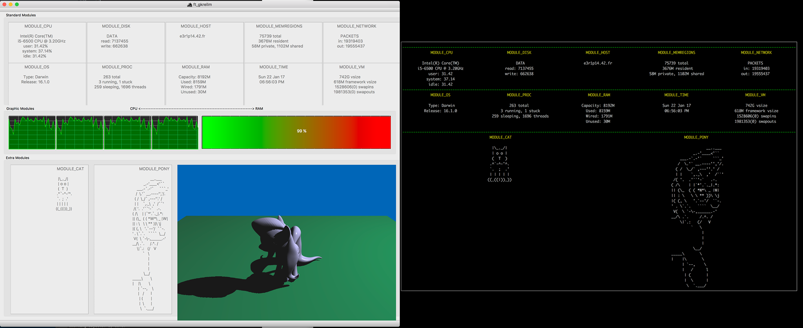
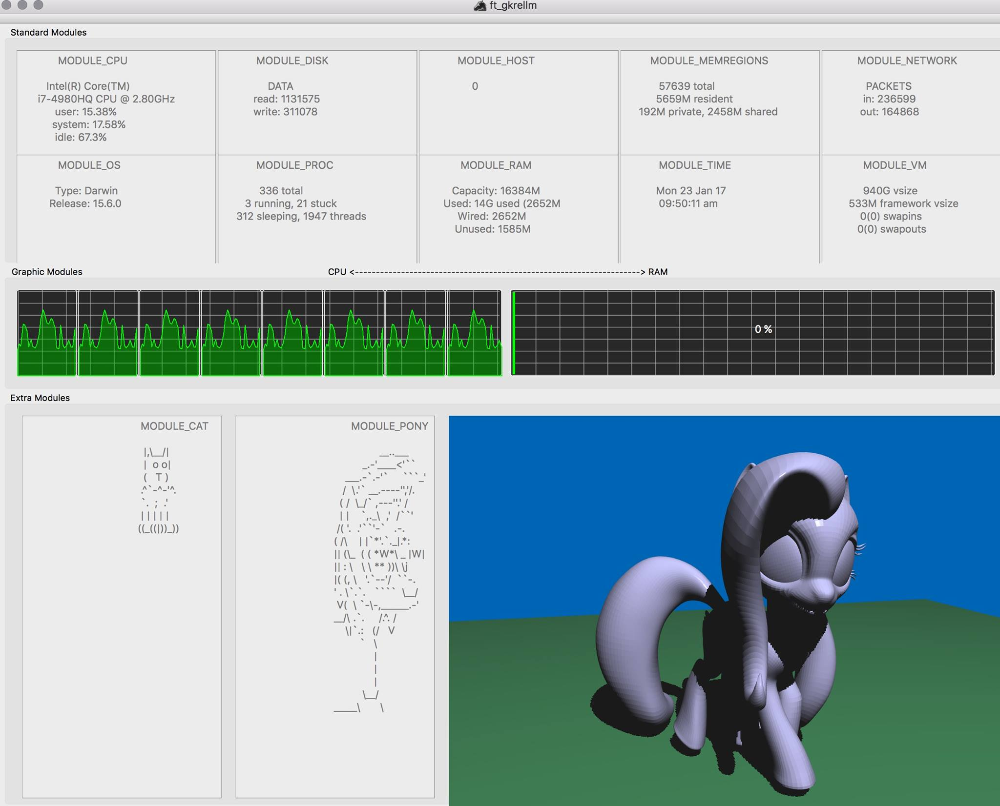
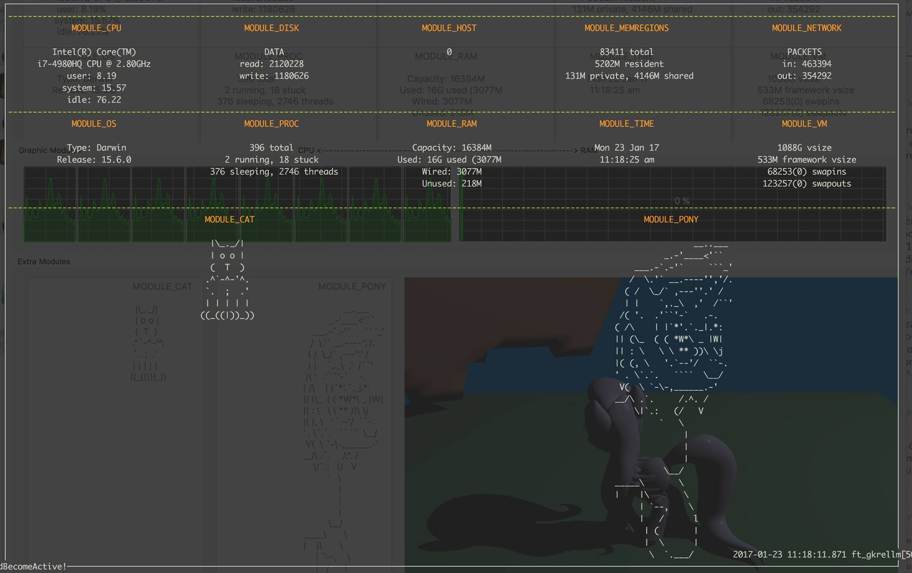
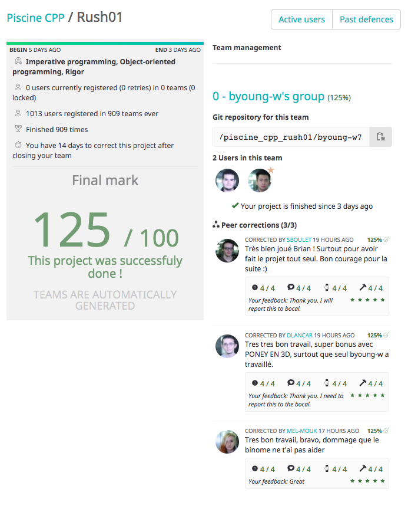

#ft_gkrellm
##System Requirements
- MacOS 10.11 and above
- Cocoa
##Instructions

~Quick Run~
1. Unzip GKrellM/QT.zip to create directory GKrellM/5.7
2. Make
3. ./ft_gkrellm

~Recommended Actions~
- Perform a full install with the included dmg.
	- See images within Installer folder for clarification.

